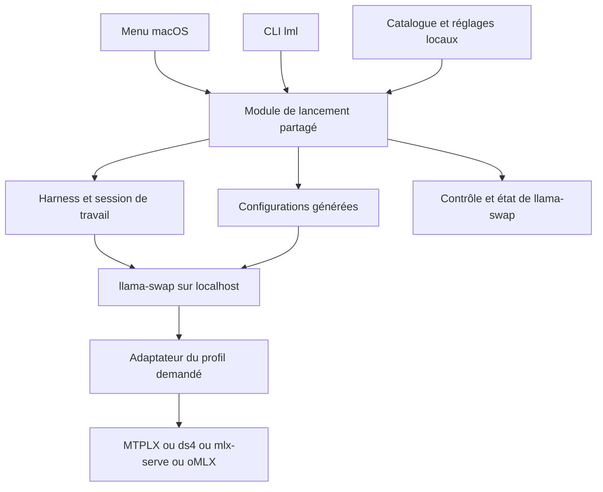
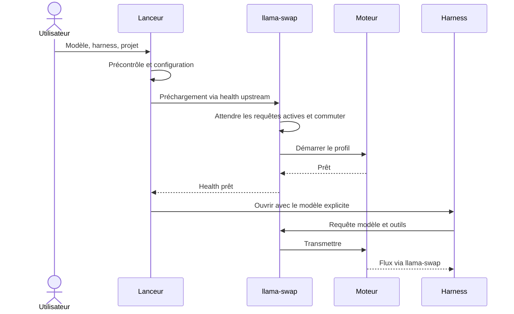
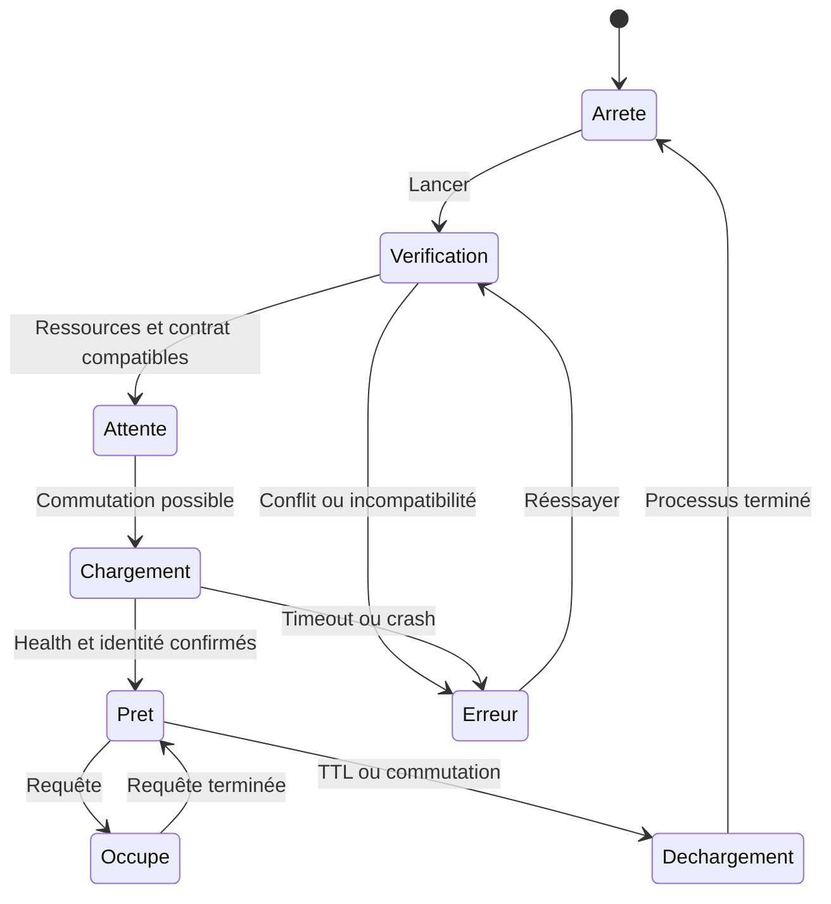

# Local Model Launcher - Plan

> **Remplacé** le 6 octobre 2026 par [le plan V2](2026-10-06-feat-model-launcher-plan.md). Conservé pour l'historique ; ses relevés locaux et son architecture llama-swap ne sont plus à jour.

## Goal Capsule

- **Objectif :** utiliser un modèle local dans le harness choisi sans ouvrir les applications d'inférence, arrêter le modèle précédent ni ressaisir sa connexion.
- **Moyen retenu :** llama-swap et un lanceur macOS, selon KTD1.
- **Autorité :** les instructions de l'utilisateur et du dépôt priment sur ce plan. Cette demande autorise la création du projet et du plan ; l'implémentation constitue la prochaine étape.
- **Livraison :** locale sur le Mac, avec vérification réelle du parcours. Publication, distribution et push ne sont pas demandés.
- **Arrêt d'une intégration :** si son moteur ne peut pas être piloté proprement ou si son protocole ne permet pas les appels d'outils attendus, conserver la preuve et afficher la limitation. Ne pas ajouter silencieusement un proxy traducteur.

---

## Product Contract

### Summary

Créer un catalogue unique et un lanceur qui configure le harness, demande le chargement du modèle à llama-swap et ouvre une session dans le projet choisi.
Le premier parcours couvre ds4 et MTPLX avec OpenCode et Pi ; les quatre moteurs et cinq harness restent la cible complète.

### Problem Frame

Le passage d'un modèle à un autre impose aujourd'hui de lancer son application, choisir les bons paramètres, libérer de la RAM et configurer chaque harness séparément.
Ces opérations répétées rendent les expérimentations coûteuses et favorisent les erreurs de port, d'identifiant et de contexte.

### Requirements

**Choix et configuration**

- R1. L'utilisateur choisit un modèle ou profil, un harness et un dossier de projet depuis une interface macOS.
- R2. Ajouter un modèle au catalogue suffit pour produire les déclarations nécessaires dans les harness pris en charge.
- R3. Chaque profil conserve le moteur, le modèle réellement servi, les limites de contexte et les capacités vérifiées, sans confondre plusieurs quantifications d'un même modèle.
- R4. Les configurations existantes des harness sont conservées ; les entrées appartenant au lanceur peuvent être ajoutées, mises à jour et retirées de manière réversible.

**Exécution locale**

- R5. Le serveur nécessaire est démarré automatiquement et déclaré prêt avant l'ouverture de la session de travail.
- R6. La commutation libère le moteur incompatible avant de charger le suivant, en respectant les requêtes en cours.
- R7. Un serveur lancé manuellement reste extérieur au périmètre géré : le lanceur signale le conflit et n'arrête pas un processus qu'il ne possède pas.
- R8. Une erreur de démarrage, un port occupé ou une mémoire insuffisante produit une explication exploitable et laisse possible un nouvel essai.
- R9. Les requêtes passent par une adresse locale stable ; aucun repli cloud ni LiteLLM n'intervient dans cette version.

**Compatibilité et suivi**

- R10. Chaque couple profil/harness a un état « non testé », « validé », « limité » ou « incompatible », associé à des versions et à une preuve de vérification.
- R11. La validation d'un harness inclut une réponse en streaming et un appel d'outil suivi de la réponse finale. Une réponse de chat seule ne suffit pas.
- R12. Le lanceur affiche le chargement, le modèle actif, les erreurs et l'arrêt ; une session garde son identifiant de modèle explicite lorsque d'autres sessions sont ouvertes.

### Scope Boundaries

Cette version vise un Mac Apple Silicon, les modèles déjà téléchargés et les moteurs MTPLX, mlx-serve, ds4 et oMLX.
Les clients visés sont OpenCode, Pi, Codex, DeepSeek Harness et Cline Desktop. Codex CLI est le premier point d'intégration Codex ; l'app Desktop demande une preuve distincte.

Téléchargement automatique de poids, benchmark comparatif, publication d'app, réseau distant, équilibrage multi-Mac et conversion de formats de modèles sont reportés.
La reprise d'une conversation existante n'est pas nécessaire au premier parcours : le lanceur ouvre une nouvelle session dans le dossier choisi.

### Acceptance Examples

- AE1 — R1, R5, R11 : un profil MTPLX validé et Pi sont sélectionnés ; le moteur démarre, Pi utilise la bonne connexion, un outil local est exécuté et la réponse se termine.
- AE2 — R6, R12 : pendant une génération MTPLX, une demande ds4 arrive ; la génération se termine avant la commutation et la demande ds4 reçoit ensuite sa réponse.
- AE3 — R2, R4 : un modèle est ajouté puis synchronisé deux fois ; une seule entrée gérée apparaît et les fournisseurs existants sont inchangés.
- AE4 — R7, R8 : une app manuelle occupe le port nécessaire ; le lanceur identifie le conflit, ne tue aucun processus extérieur et propose de réessayer après résolution.
- AE5 — R9, R10 : Codex est choisi avec un profil sans Responses utilisable ; le couple est expliqué comme incompatible et aucune requête n'est envoyée à une autre destination.

---

## Planning Contract

### Key Technical Decisions

- KTD1. **llama-swap est le seul proxy d'inférence.** Le lanceur utilise ses interfaces de contrôle et ne relaie pas les flux de tokens. (session-settled: user-directed — chosen over LiteLLM + llama-swap: essayer d'abord llama-swap seul.) Gouverne R5, R6, R9.
- KTD2. **Partir de la release v255**, puis consigner le binaire réellement installé et son empreinte. Les contrats de configuration et d'API viennent du tag, pas de `main`. En particulier, ne pas dépendre de `globalConcurrencyLimit`, absent de cette release. Voir S1–S3.
- KTD3. **Un seul profil d'inférence lourd à la fois au départ.** Déclarer `routing.router.use: group`, le groupe sous `routing.router.settings.groups` et `routing.scheduler.use: fifo` selon v255. Le délai d'inactivité proposé est de 10 minutes. Ce scheduler peut favoriser les nouvelles requêtes du modèle déjà prêt : ne pas promettre un FIFO strict ni un délai maximal sans mesure. Le budget tient compte des poids, du contexte et de la pression mémoire.
- KTD4. **Les moteurs tournent au premier plan sous la propriété de llama-swap.** Préférer la commande directe ou un wrapper qui termine par `exec`, et l'arrêt natif du groupe de processus POSIX fourni par llama-swap. Renseigner explicitement son délai d'arrêt. Aucun arrêt global par nom, aucune commande qui réutilise implicitement le démon d'une app. Une demande du nouveau modèle déclenche la commutation normale ; l'API administrative unload ne doit pas précéder cette demande, car elle annule les requêtes concernées.
- KTD5. **Une source de configuration, plusieurs sorties.** Un catalogue JSON versionné décrit profils et capacités ; une configuration locale non suivie contient chemins et préférences machine. Générer le YAML de llama-swap et les entrées des harness depuis cette source. Les écritures sont atomiques, sauvegardées et limitées à l'espace de noms `local-launcher`.
- KTD6. **Chaque profil a un identifiant stable et immuable pour ses sessions.** Pas d'alias global `current` qui redirigerait une conversation existante. Plusieurs sessions peuvent attendre la commutation ; elles ne changent pas de modèle à leur insu. Un changement de paramètres nécessitant un redémarrage crée une nouvelle révision du profil.
- KTD7. **Appliquer un catalogue par arrêt/redémarrage coordonné, sans hot reload v255.** Le lanceur partage un verrou de maintenance entre CLI et app : il bloque les nouveaux lancements et attend la fermeture de ses sessions ainsi que la fin des requêtes observées. Il arrête ensuite l'ancien proxy et ses moteurs, vérifie leur disparition, installe le fichier validé puis redémarre le proxy sans préchargement. Ne pas utiliser SIGHUP ni `-watch-config` : v255 peut démarrer le nouveau serveur avant d'avoir arrêté l'ancien. Un instantané `/running` vide ne suffit pas à autoriser l'opération. Si des clients extérieurs peuvent encore appeler le proxy, conserver l'application en attente et demander leur fermeture ; cette première version garantit la maintenance seulement pour les sessions gérées. Les ajouts restent « à appliquer » tant que ces conditions ne sont pas réunies.
- KTD8. **Swift partagé entre CLI et interface SwiftUI.** Utiliser Foundation pour les fichiers/processus/HTTP, Swift Argument Parser pour la CLI et Yams pour le YAML. Verrouiller les dépendances dans `Package.resolved`. L'interface appelle le même module que la CLI ; aucun second gestionnaire de modèles.
- KTD9. **Compatibilité par protocole et version.** La présence de `/v1/responses` dans llama-swap ne crée pas une implémentation Responses dans le moteur. Les adaptateurs de harness conservent leurs restrictions de rôle, outils, raisonnement et contexte. Voir S4–S7.
- KTD10. **Persister la preuve de propriété des processus.** Un registre local atomique enregistre l'instance de service, le profil, PID/groupe, utilisateur, instant de création et exécutable attendu. Les adaptateurs l'alimentent lors du lancement ; la récupération vérifie l'identité courante avant tout signal afin d'éviter la réutilisation d'un PID. Une identité absente ou ambiguë bloque un nouveau chargement et signale le processus à examiner, sans arrêt automatique. Les enregistrements périmés sont retirés après vérification. Ce registre ne supervise pas les moteurs : llama-swap reste leur gestionnaire.

### Assumptions

Les choix suivants sont des valeurs de départ techniques, ajustables pendant l'implémentation sans modifier l'objectif :

- Utiliser ds4 et MTPLX pour la première commutation, avec deux modèles déjà présents et dont l'empreinte mémoire est mesurée.
- Valider OpenCode classique et Pi avant les autres clients ; traiter OpenCode2 comme une variante distincte.
- Proposer une réserve système initiale égale au maximum de 16 Gio et 20 % de la RAM physique, configurable. Le diagnostic combine cette marge à la pression mémoire et aux processus externes détectés ; il ne garantit pas à lui seul l'absence d'OOM.
- Utiliser un port localhost disponible, mémorisé après installation. Les ports des moteurs sont distincts et attribués par llama-swap lorsque l'adaptateur le permet.
- Ouvrir Terminal pour les harness CLI au premier incrément. Conserver le dossier projet et construire les arguments sans interpolation de commande provenant du catalogue.
- Mémoriser le chemin absolu et la version du Node compatible retenu, puis transmettre explicitement cet environnement au processus du harness, y compris depuis Terminal. Un runtime absent rend le lancement indisponible avant le préchargement ; ne pas dépendre du shell interactif de l'utilisateur.

### High-Level Technical Design





Le préchargement utilise le mécanisme upstream de v255, avec le chemin health du moteur ; ne pas inventer d'endpoint `POST /api/models/load`.
Une vérification de disponibilité doit aussi confirmer l'identité du modèle ; le `/health` du proxy seul ne prouve pas que les poids sont chargés.



Ces états concernent les processus et requêtes observables. Une pause entre deux appels d'outils n'est pas une fin de conversation ; le moteur peut être rechargé pour la requête suivante de la même session.
L'annulation de l'attente du lanceur ne doit pas décharger un modèle utilisé par une autre session.

### Local Evidence

Relevé du 15 septembre 2026, en lecture seule. Les chemins machine seront résolus par le diagnostic, sans devenir des constantes du dépôt.

| Composant | Preuve disponible | Conséquence pour le plan |
|---|---|---|
| llama-swap | Non trouvé dans le PATH de cette session | Installation et vérification du binaire à réaliser en U2 |
| MTPLX | CLI et app présentes ; `serve` accepte modèle, identifiant servi, host et port | Vérifier la propriété du processus et la libération mémoire en U2 |
| ds4 | Checkout actif sous `projects/contributions/ds4`, distinct de l'ancien `projects/lab/ds4` | Utiliser un chemin explicite vers les poids, pas le lien mutable `ds4flash.gguf` |
| mlx-serve | App MLX Core présente ; binaire non trouvé dans le PATH | Résoudre le binaire embarqué ; son aide n'a pas pu s'exécuter sous le sandbox Metal |
| oMLX | CLI et app présentes ; `serve --model-dir`, état persistant et découverte du cache HF | Isoler `--base-path`, utiliser `--no-hf-cache` et une vue de répertoire propre au profil |
| OpenCode | Aide locale : dossier positional et `--model provider/model` | Adaptateur direct ; lire version et mécanisme de surcharge avant génération |
| Pi | Package installé 0.84.4 ; `models.json`, `--provider`, `--model` documentés | Entrées gérées et profils explicites ; ne pas remplacer tout le dossier utilisateur |
| Node/Pi | Pi exige Node ≥22.19 ; l'appel local a utilisé 22.13.0 et échoué sur un verrou sandbox avant l'aide | Résoudre un Node compatible par processus ; ne pas changer le Node global |
| DeepSeek Harness | Checkout `projects/lab/deepseek-harness`, 0.1.2-rc.1, Node ^22.19 ou ≥24 | Utiliser les profils `dsh`, les patches documentés et `llm-pi-ai` |
| Codex | CLI présente ; profils, sélection de modèle et provider local documentés | Prouver Responses sur le couple choisi ; distinguer CLI et Desktop |
| Cline Desktop | App présente | Contrat d'import/sélection/ouverture de session à établir en U5 |

Les anciens essais ds4/OpenCode2 constituent seulement un indice : le chat simple avait fonctionné, la continuation avec outils restait non validée. Aucun résultat ancien ne classe aujourd'hui un couple comme « validé ».

Le code installé MTPLX 2.11.1 confirme que `serve` remplace son processus par le serveur au premier plan. Le checkout ds4 documente désormais Chat, Responses et Messages ; ces déclarations restent à éprouver avec chaque harness. Son chargement précède le service HTTP et `/v1/models` est la sonde retenue, sans supposer l'existence de `/health`.

### Output Structure

Structure cible, à créer pendant l'implémentation ; seuls README, ignore et documentation existent au départ.

```text
Package.swift
Package.resolved
Sources/
  LauncherCore/
    Catalog/
    Runtime/
    Engines/
    Harnesses/
  LauncherCLI/
  LauncherApp/
Tests/
  LauncherCoreTests/
  IntegrationTests/
config/
  catalog.example.json
  local.example.json
packaging/
  launchd/
docs/
  plans/
  compatibility.md
  operations.md
```

### Risks and Deferred Checks

- La mesure RAM réelle, la détection d'une fin de chargement et la propagation des signaux se prouvent sur le Mac pendant U2/U4. Les sources statiques ne suffisent pas.
- La file de requêtes concurrentes ne garantit pas des délais compatibles avec tous les harness ; mesurer un démarrage à froid et régler les timeouts côté client.
- L'app d'un moteur peut maintenir son propre service. Le précontrôle doit le détecter et laisser l'utilisateur fermer ce service avant sa première prise en charge par le lanceur.
- Pour Cline Desktop, si aucune surface stable ne permet le parcours automatique, conserver l'intégration bloquée avec la preuve. Une configuration manuelle ne satisfait pas le critère de livraison complet ; décider alors d'une automatisation UI ciblée ou d'une évolution explicite du périmètre.
- Si aucun moteur sélectionné ne fournit les échanges Responses requis par Codex, l'intégration Codex est bloquée. Une passerelle de traduction nécessiterait une nouvelle décision de l'utilisateur, car R9/KTD1 fixent l'architecture.

---

## Implementation Units

### U1. Catalogue et diagnostic local

**But :** représenter un profil complet et diagnostiquer ses prérequis sans charger de modèle. Couvre R2, R3, R7, R10. Aucune dépendance.

**Fichiers :** `Package.swift`, `Sources/LauncherCore/Catalog/`, `Sources/LauncherCore/Runtime/Doctor.swift`, `Sources/LauncherCLI/`, `config/catalog.example.json`, `config/local.example.json`, `Tests/LauncherCoreTests/CatalogTests.swift`, `Tests/LauncherCoreTests/DoctorTests.swift`.

**Approche :** implémenter KTD5/KTD8, résoudre les binaires et versions, séparer les faits découverts des capacités déclarées. Le catalogue expose les limites, l'identité upstream et les preuves par couple. Le diagnostic n'installe ni ne démarre les moteurs.

**Scénarios :**

1. Deux quantifications gardent des identifiants différents et leurs limites propres.
2. Un chemin avec espaces ou caractères de shell reste une donnée, sans exécution supplémentaire.
3. Un binaire absent, un Node incompatible ou un profil incomplet sont signalés avant mutation.
4. Une preuve portant sur une autre version ne conserve pas abusivement l'état « validé ».

**Validation :** catalogue lisible, erreurs déterministes et diagnostic exploitable pour les quatre moteurs et cinq harness.

### U2. llama-swap, ds4 et MTPLX

**But :** prouver la commutation réelle de deux moteurs. Couvre R5–R9, R12 et AE2/AE4. Dépend de U1.

**Fichiers :** `Sources/LauncherCore/Runtime/SwapController.swift`, `Sources/LauncherCore/Runtime/ConfigurationWriter.swift`, `Sources/LauncherCore/Engines/DS4.swift`, `Sources/LauncherCore/Engines/MTPLX.swift`, `Tests/LauncherCoreTests/ConfigurationWriterTests.swift`, `Tests/IntegrationTests/SwapLifecycleTests.swift`.

**Approche :** installer la release KTD2, valider le fichier candidat avec le mode de validation du binaire, créer les adaptateurs KTD4 et vérifier les paramètres de contexte/model ID. Utiliser MTPLX `serve` sans les variantes de supervision/ventilation et ds4 avec son répertoire de travail explicite. Mesurer chargement et déchargement avec deux profils existants avant d'ajouter une interface graphique.

**Scénarios :**

1. Première demande : un seul serveur correct démarre, health et identité concordent.
2. Requête longue puis demande de l'autre profil : aucune coupure du flux actif, puis commutation.
3. TTL, arrêt explicite et crash : aucun descendant d'inférence orphelin, diagnostic et nouvel essai possibles.
4. Port occupé par une app externe : échec explicite, aucun signal envoyé à cette app.
5. Deux demandes simultanées du même profil ne créent pas deux processus.
6. Catalogue modifié pendant une requête : application différée, aucun reload destructeur caché.
7. Arrivées continues sur l'ancien modèle et saturation de la limite par modèle : attente visible ou 429 correctement remonté, sans prétendre garantir l'équité du scheduler.

**Validation :** preuves horodatées des réponses, PID/ports et évolution mémoire. Les tests de protocole utilisent d'abord de petits serveurs fixtures ; la preuve Metal/RAM utilise ensuite les vrais moteurs.

### U3. Lancement OpenCode et Pi

**But :** livrer le premier parcours utilisable depuis la CLI. Couvre R2–R4, R10–R12 et AE1/AE3 ; prépare R1, dont l'interface macOS est livrée par U6. Dépend de U2.

**Fichiers :** `Sources/LauncherCore/Harnesses/OpenCode.swift`, `Sources/LauncherCore/Harnesses/Pi.swift`, `Sources/LauncherCore/Harnesses/ConfigurationTransaction.swift`, `Sources/LauncherCore/Runtime/SessionLauncher.swift`, `Sources/LauncherCore/Runtime/MaintenanceCoordinator.swift`, `Tests/LauncherCoreTests/HarnessConfigurationTests.swift`, `Tests/IntegrationTests/HarnessLaunchTests.swift`.

**Approche :** déclarer `local-launcher` dans les formats natifs. Préférer une surcharge par invocation lorsqu'elle préserve les réglages utilisateur ; sinon fusionner uniquement l'entrée gérée. Imposer fournisseur local, endpoint, modèle explicite et projet sélectionné, avec l'environnement runtime validé. Enregistrer la durée de vie des sessions pour KTD7. OpenCode2 fait l'objet d'un adaptateur de version séparé s'il est activé.

**Scénarios :**

1. Synchronisation répétée sans doublon ni suppression d'un fournisseur existant.
2. Config JSONC, fichier invalide ou édition concurrente : préserver le fichier, expliquer le conflit, ne pas l'écraser.
3. Ouvrir chacun des deux harness dans un projet de test contenant des espaces dans son chemin.
4. Réponse streaming, lecture d'un fichier de test par outil et réponse finale pour chaque couple déclaré validé.
5. Deux sessions avec modèles différents gardent leurs identifiants après commutation.
6. Application du catalogue demandée pendant une session, puis tentative de nouveau lancement pendant maintenance : application différée puis lancement suspendu jusqu'à la fin de l'opération.

**Validation :** choix du modèle et du harness depuis la CLI, zéro saisie de connexion au lancement. Sauvegarde et restauration démontrées sur des configurations fixtures puis sur les seules entrées gérées.

### U4. Adaptateurs mlx-serve et oMLX

**But :** étendre la même orchestration aux quatre moteurs. Couvre R3, R5–R8, R10. Dépend de U2 ; réutilise U3 pour la preuve agentique.

**Fichiers :** `Sources/LauncherCore/Engines/MLXServe.swift`, `Sources/LauncherCore/Engines/OMLX.swift`, `Tests/LauncherCoreTests/EngineProfileTests.swift`, `Tests/IntegrationTests/EngineLifecycleTests.swift`.

**Approche :** résoudre le binaire embarqué MLX Core et ses flags à la version installée. Pour oMLX, isoler l'état avec `--base-path`, désactiver la découverte HF avec `--no-hf-cache` et présenter le seul modèle du profil dans un répertoire de liens. Initialiser l'état isolé pour précharger uniquement ce modèle, puis lancer `serve` au premier plan. Vérifier que le health reste non prêt pendant son chargement ; l'énumération seule d'un modèle disponible sur disque ne vaut pas chargement. Imposer localhost aux deux moteurs.

**Scénarios :**

1. Modèle déjà sur disque réutilisé sans copie des poids.
2. Répertoire oMLX ne permettant pas de charger un autre profil à l'insu de llama-swap.
3. App externe active détectée sans tentative de prise de contrôle.
4. Changement entre chacun des quatre moteurs, arrêt réel et absence de processus orphelin.

**Validation :** au moins un profil opérationnel par moteur, testé via le proxy et avec un harness, avec résultats de RAM/arrêt consignés.

### U5. Codex, DeepSeek Harness et Cline Desktop

**But :** rendre les autres clients sélectionnables avec un niveau de compatibilité prouvé. Couvre R1–R4, R9–R12 et AE5. Dépend de U3/U4.

**Fichiers :** `Sources/LauncherCore/Harnesses/Codex.swift`, `Sources/LauncherCore/Harnesses/DeepSeekHarness.swift`, `Sources/LauncherCore/Harnesses/ClineDesktop.swift`, `Tests/LauncherCoreTests/CompatibilityTests.swift`, `Tests/IntegrationTests/AdditionalHarnessTests.swift`, `docs/compatibility.md`.

**Approche :** Codex utilise un provider/profil local et un modèle explicite, avec preuve Responses native. DeepSeek Harness utilise son profil et patch documentés, avec une route `llm-pi-ai` sans modifier son dépôt. Pour Cline, établir d'abord le contrat public de configuration et de sélection de modèle de l'app installée. Ne pas réécrire une base Electron privée pour simuler une intégration supportée.

**Scénarios :**

1. Protocole manquant : refus avant lancement avec explication du couple concerné.
2. Appels d'outils puis continuation, et réponses en streaming, sur chaque couple activé.
3. Configuration existante préservée et retrait des seules entrées gérées.
4. Cline Desktop ouvert sur le modèle réellement choisi, pas seulement sur sa fenêtre d'accueil.
5. DSH avec un Node compatible et un patch valide ; défaut cloud absent de la route sélectionnée.

**Validation :** un parcours complet par harness, avec la version et le moteur utilisés. Une limitation identifiée est un résultat d'investigation, pas une intégration terminée.

### U6. Interface macOS dans la barre des menus

**But :** rendre le parcours accessible sans terminal de configuration. Couvre R1, R8, R10, R12. Dépend de U3 ; consomme les adaptateurs U4/U5 lorsqu'ils sont prêts.

**Fichiers :** `Sources/LauncherApp/`, `Sources/LauncherCore/Runtime/LauncherState.swift`, `Tests/LauncherCoreTests/LauncherStateTests.swift`, `docs/ui-verification.md`.

**Approche :** sélecteurs de modèle, harness et projet, puis bouton Lancer. Afficher la progression, les limitations et un accès aux journaux techniques. Réutiliser le module CLI ; ne pas ajouter d'API réseau de contrôle propre à l'app.

**Scénarios :**

1. Parcours entièrement au clavier et intitulés accessibles.
2. Double clic sur Lancer : un seul lancement de session.
3. Chargement long : progression visible et annulation sans interrompre un autre utilisateur du modèle.
4. Erreur moteur, profil incompatible et processus externe : état lisible et possibilité de réessayer.
5. Fermer le menu ou l'app ne coupe pas un flux d'inférence en cours.

**Validation :** preuve visuelle du parcours sur le Mac et cohérence des états avec ceux observés en CLI.

### U7. Service utilisateur et exploitation quotidienne

**But :** rendre le montage durable et réversible. Couvre R4–R9, R12. Dépend de U6 et des adaptateurs livrés.

**Fichiers :** `packaging/launchd/`, `Sources/LauncherCore/Runtime/ServiceInstaller.swift`, `Sources/LauncherCore/Runtime/ProcessOwnership.swift`, `Tests/LauncherCoreTests/ServiceInstallerTests.swift`, `Tests/LauncherCoreTests/ProcessOwnershipTests.swift`, `Tests/IntegrationTests/ServiceRecoveryTests.swift`, `docs/operations.md`, `README.md`.

**Approche :** installer llama-swap comme LaunchAgent utilisateur unique, avec chemins absolus résolus et environnement explicite. L'app est son client, pas un deuxième superviseur. Conserver configuration locale, snapshots, registre KTD10 et logs dans Application Support, avec permissions utilisateur et rotation. Au redémarrage, réconcilier les processus selon KTD10 avant tout nouveau chargement.

**Scénarios :**

1. Installation répétée : un seul service et un seul port d'écoute.
2. Redémarrage de session macOS : service disponible, aucun poids chargé sans demande.
3. Crash du proxy avec moteur vivant : récupération sans doublon et sans tuer un processus étranger.
4. Désinstallation : service arrêté, entrées gérées retirées, réglages ajoutés par l'utilisateur entre-temps conservés.
5. Veille/réveil pendant ou après une génération : erreur visible ou reprise prouvée, aucun succès fictif.
6. Registre périmé avec PID réutilisé par un processus étranger : aucun signal envoyé ; identité ambiguë signalée et chargement bloqué.

**Validation :** installation, usage après reconnexion et retour arrière documentés et exercés sur le Mac.

---

## Verification Contract

Le dépôt étant neuf, aucune suite ni commande de build n'existe encore. U1 doit fournir les commandes du package Swift ; les validations ci-dessous deviennent les critères de son manifeste.

| Niveau | Périmètre | Preuve attendue |
|---|---|---|
| Tests du module | Catalogue, génération, transactions, états, compatibilité | Entrées/sorties et erreurs couvertes sans modèles réels |
| Intégration proxy | Configuration v255, health, FIFO, swap, TTL, signaux, reload | Vrai binaire llama-swap et petits serveurs fixtures |
| Intégration moteur | Au moins un profil de chaque moteur | Poids déjà présents, identité et réponse réelles, PID/ports, évolution mémoire |
| Intégration harness | Un parcours par client et par couple déclaré validé | Streaming, appel d'outil local contrôlé et continuation |
| Interface | Menu, choix, attente, erreurs, clavier | Examen visuel et parcours manuel sur macOS |
| Exploitation | LaunchAgent, crash, reconnexion, désinstallation | Absence de doublons et restauration ciblée |

Les scénarios agentiques utilisent un répertoire de test sans données client. Les tests d'intégration lourds sont explicitement sélectionnés, jamais déclenchés par les tests unitaires.
Une preuve de compatibilité enregistre les versions, le profil, ses limites, les capacités exercées et la date ; elle ne stocke pas de prompts de travail privés.
Les délais d'attente sont établis à partir de mesures à froid et à chaud. Aucune cible de performance chiffrée n'est affirmée avant ces mesures.

---

## Definition of Done

**Premier jalon technique utilisable en CLI — U1 à U3 :** sélectionner ds4 ou MTPLX avec OpenCode ou Pi suffit à obtenir une session fonctionnelle, avec commutation réelle et configurations existantes préservées. Le menu macOS de R1 arrive en U6 et n'est pas inclus dans ce jalon intermédiaire.

**Version complète — U1 à U7 :**

- Les quatre moteurs disposent d'au moins un profil validé.
- Chacun des cinq harness dispose d'au moins un couple validé, ouvert automatiquement depuis le lanceur ; les autres couples portent leur état réel.
- Ajouter un modèle au catalogue puis appliquer sa configuration ne requiert pas de ressaisie dans chaque harness supporté.
- Les flux en cours, les processus externes et les configurations utilisateur sont protégés selon R4/R6/R7.
- Le menu macOS, le service utilisateur et le retour arrière sont exercés.
- Les expériences abandonnées, fixtures temporaires et processus de test sont nettoyés ; aucune donnée de modèle ou configuration privée n'entre dans le dépôt.

Un blocage Cline ou Codex n'empêche pas de livrer le premier jalon, mais empêche d'annoncer la version complète terminée.

---

## Sources

- S1. [llama-swap v255 — release](https://github.com/mostlygeek/llama-swap/releases/tag/v255).
- S2. [llama-swap v255 — configuration](https://github.com/mostlygeek/llama-swap/blob/v255/docs/config.example.yaml).
- S3. [llama-swap v255 — code source](https://github.com/mostlygeek/llama-swap/tree/v255) : routage, file, APIs et rechargement à relire au pin retenu.
- S4. [MTPLX](https://github.com/youssofal/MTPLX), [mlx-serve](https://github.com/ddalcu/mlx-serve), [oMLX](https://github.com/jundot/omlx) : CLI et protocoles ; les flags doivent correspondre aux binaires installés.
- S5. [OpenCode — providers](https://opencode.ai/docs/providers/), [Pi — modèles personnalisés](https://github.com/earendil-works/pi/blob/main/packages/coding-agent/docs/models.md). Documentation locale Pi 0.84.4 également consultée.
- S6. [Documentation officielle OpenAI — configuration avancée](https://learn.chatgpt.com/docs/config-file/config-advanced).
- S7. [Cline — OpenAI compatible](https://docs.cline.bot/provider-config/openai-compatible), [DeepSeek Harness](https://github.com/deepseek-ai/deepseek-harness). La documentation Cline générique ne prouve pas l'automatisation de Desktop.
- S8. Dans le checkout local DeepSeek Harness : `apps/cli/reference/README.md`, `packages/llm/llm-pi-ai/README.md` et `package.json` établissent profils, patches, route personnalisée et version Node.
- S9. Dans le checkout actif ds4 : `AGENT.md`, `README.md`, `docs/SERVER.md` et `ds4_server.c` établissent le verrou d'instance, les chemins, les protocoles et les signaux. Dans le package MTPLX 2.11.1 installé : `mtplx/commands/public.py` et `mtplx/server/openai.py`. Dans les ressources de l'app oMLX : `omlx/cli.py` et `omlx/server.py`.
